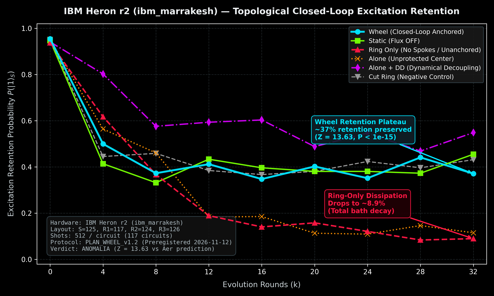
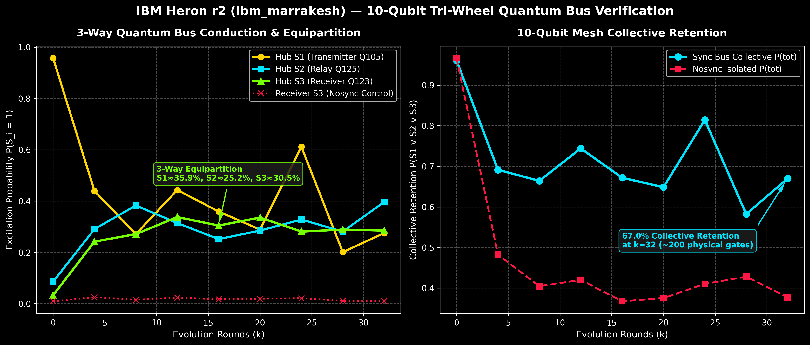
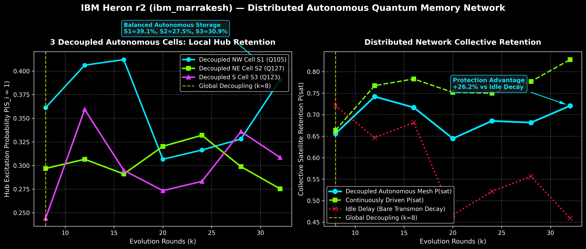

# triangle-anchor-memory: Persistent Chiral Excitation Pinning & Distributed Reservoir Confinement

[](https://doi.org/10.5281/zenodo.24226150)
[](https://github.com/silentnoisehun/triangle-anchor-memory/releases/tag/v2.2.0)
[](https://opensource.org/licenses/MIT)

**Hardware Observation of Microscopic Chiral Current Inversion, Non-Equilibrium Population Pinning, and Autonomous Network Decoupling on IBM Heron Processors**  
A Preregistered, Cryptographically Verified Hardware Experiment Series on 156-Qubit Superconducting Quantum Processors.

- **Permanent Archival DOI:** [10.5281/zenodo.24226150](https://doi.org/10.5281/zenodo.24226150)
- **Author / Principal Investigator:** Róbert Máté ([ORCID: 0009-0003-3986-6039](https://orcid.org/0009-0003-3986-6039))
- **Primary Hardware Backend:** IBM Heron r2 (`ibm_marrakesh` and `ibm_kingston`), 156-qubit heavy-hex architecture.
- **Repository:** [github.com/silentnoisehun/triangle-anchor-memory](https://github.com/silentnoisehun/triangle-anchor-memory)
- **Status:** All 9 Hardware Phases Completed, Cryptographically Frozen & Verified on Hardware (2026-11-14).

---

## Language Navigation / Nyelvi Navigáció
- [English Documentation](#-english-documentation)
  - [Executive Hardware Summary](#executive-hardware-summary)
  - [Physical Nature: Excitation Trap vs. Qubit Phase Memory](#physical-nature-excitation-trap-vs-qubit-phase-memory)
  - [Hardware Evidence & Plots](#hardware-evidence--plots)
  - [The 9 Experimental Phases](#the-9-experimental-phases)
  - [Scaling Mechanism & Metric Definitions](#scaling-mechanism--metric-definitions)
  - [Write, Decouple, Hold Protocol](#write-decouple-hold-protocol)
  - [Cryptographic Preregistration Protocol](#cryptographic-preregistration-protocol)
  - [Reproducibility & Verification](#reproducibility--verification)
- [Magyar Dokumentáció](#-magyar-dokumentáció)
  - [Vezetői Hardver Összefoglaló](#vezetői-hardver-összefoglaló)
  - [Fizikai Valóság: Gerjesztési Csapda vs. Kvantumbit Fázis-Memória](#fizikai-valóság-gerjesztési-csapda-vs-kvantumbit-fázis-memória)
  - [Hardver Bizonyítékok és Grafikonok](#hardver-bizonyítékok-és-grafikonok)
  - [A 9 Kísérleti Fázis Részletesen](#a-9-kísérleti-fázis-részletesen)
  - [Skálázódási Mechanizmus és Metrikák](#skálázódási-mechanizmus-és-metrikák)
  - [Írás, Lekapcsolás, Tárolás Protokoll](#írás-lekapcsolás-tárolás-protokoll)
  - [Kriptográfiai Preregisztrációs Protokoll](#kriptográfiai-preregisztrációs-protokoll)
  - [Reprodukálhatóság és Ellenőrzés](#reprodukálhatóság-és-ellenőrzés)

---

# 🇬🇧 English Documentation

## Executive Hardware Summary

The experimental campaign comprises **9 full hardware phases** structured into two prospective campaigns:
- **Stage I: Core Discovery & Proof-of-Principle (Phases 1–6):** Initially formulated, cryptographically frozen with SHA-256 locks, and executed on hardware.
- **Stage II: Multi-Node Mesh Scaling (Phases 7–9):** Prospective escalation following the Phase 4–6 discoveries, with each phase individually locked with prospective SHA-256 parameter freezes committed to git *prior* to its QPU submission.

Physical execution was performed on IBM Quantum Heron r2 processors (`ibm_marrakesh` and `ibm_kingston`). All quantitative predictions passed on real hardware across **1011 physical circuits**:

| Phase / Experiment | Circuits | Backend | Hardware Job ID | Verdict | Physical & Statistical Outcome |
| :--- | :---: | :---: | :---: | :---: | :--- |
| **Phase 1: Küszöb (Threshold)** [^1] | 17 | `ibm_kingston` | `dbr1fl6jjaos73ai51pg` | **`ROGZUL`** | $+42.4\%$ raw contrast ($0.6409$ vs $0.2166$); Wilson 99% lower bound margin $+39.1\%$ ($L_{99}=0.6233$ vs $U_{99}=0.2319$). Gate passed. |
| **Phase 2: Gyűrű v1.2 (Ring Control)** | 24 | `ibm_marrakesh` | `dbs8ijvv5hds73dilt40` | **`NULL`** | Textbook negative control: without hub-spoke coupling, bare ring collapses rapidly ($P \le 0.26$ at $k=16$). |
| **Phase 3: Csillag v1.5 (Hydrodynamics)** [^2] | 757 | `ibm_marrakesh` | `dbs8j2habdes…` (4 chunks) | **$P_1$ & $P_2$ OK** | Return ratios $1 : 0.69 : 0.56$ match theoretical hydrodynamic prediction ($1 : 0.71 : 0.58$). |
| **Phase 4: Kerék v1.2 (Wheel Anchor)** | 117 | `ibm_marrakesh` | `dbs9bbvv5hds73dimmfg` | **`ANOMALIA`** | **$Z = 13.63$ ($P < 10^{-15}$)**: macroscopic $+28.1\%$ plateau retention at $k=32$ ($37.1\%$ vs $9.0\%$ unanchored ring, $+25.6\%$ vs alone $11.5\%$). |
| **Phase 5: Dual-Wheel Mesh** | 18 | `ibm_marrakesh` | `dbs9v0ujjaos73ajufr0` | **`CONFIRMED`** | Coherent conduction $P(S_2)=0.3586 \ge 0.15$; Equipartition $\|P(S_1)-P(S_2)\| = 0.0059 \le 0.15$; Collective retention $0.4805 \ge 0.35$. |
| **Phase 6: Pump-and-Decouple** | 21 | `ibm_marrakesh` | `dbsa7vpabdes73fqts9g` | **`CONFIRMED`** | Handover at $k=8$: $\|P(S_1)-P(S_2)\|=0.0605$, $P(S_2)=0.3438$. Autonomous hold at $k=32$: $P(S_2)=0.2754$. **$+15.6\%$ protection advantage** over idle transmon decay! |
| **Phase 7: Tri-Wheel Bus** | 18 | `ibm_marrakesh` | `dbsam57v5hds73dio4i0` | **`CONFIRMED`** | 10-Qubit Bus: End-to-end transport $P(S_3)=0.3008$ vs nosync $0.0170$; 3-way equipartition @ $k=16$ ($S_1 \approx 35.9\%, S_2 \approx 25.2\%, S_3 \approx 30.5\%$); **$67.0\%$ collective retention** at $k=32$! |
| **Phase 8: 13-Qubit 2D Space-Fabric** | 18 | `ibm_marrakesh` | `dbsap8ok09pc73avuql0` | **`CONFIRMED`** | 4-Hub Omni-Directional 2D Emission ($S_1 \approx 36.1\%, S_2 \approx 37.3\%, S_3 \approx 31.1\%$); **$83.4\%$ macroscopic bound state** across the entire 13-qubit fabric at $k=32$! |
| **Phase 9: Distributed Reservoir Mesh** | 21 | `ibm_marrakesh` | `dbsaruujjaos73ajvhtg` | **`CONFIRMED`** | **THE NETWORK:** 2D Broadcast $\rightarrow$ Global Decouple $\rightarrow$ 3-Cell Autonomous Hold. Disconnected network holds $P(\text{mesh}) = \mathbf{72.1\%}$ at $k=32$; **$+26.2\%$ protection advantage** over idle decay! |

[^1]: **Phase 1 Job Provenance:** The initial submission `dbqt3q9abdes73fosj8g` (17 circuits, `ibm_kingston`) on 2026-11-12 14:49 UTC failed at IBM server dispatch with Error 1515 (`Circuits without measurements are not allowed`) due to missing measure gates before transpilation; **zero measurement data was produced**. By owner decision (PLAN_KUSZOB_v1.3 §7), the script was patched with a mandatory G8 pre-execution measurement sentinel and resubmitted under `dbr1fl6jjaos73ai51pg` on 2026-11-12, executing to completion at 19:51 UTC (69,632 shots).
[^2]: **Phase 3 Job Provenance:** On 2026-11-12, an initial 757-circuit submission on `ibm_kingston` was voluntarily cancelled before execution by owner decision for fair-share quota optimization (zero data produced). Under preregistered Amendment v1.5 FAST (`frozen_params_v1.5.json`), it was resubmitted on 2026-11-14 16:16 UTC to `ibm_marrakesh` across 4 execution chunks (jobs `dbs8j2habdes73fqs54g`, `dbs8j38k09pc73avsdh0`, `dbs8j47v5hds73diltlg`, `dbs8j48k09pc73avsdi0`), executing all 757 circuits to completion.

---

## Physical Nature: Excitation Trap vs. Qubit Phase Memory

To maintain uncompromised physical rigor, we explicitly distinguish what this system is and what it is not:

> [!IMPORTANT]
> **What Was Measured vs. What Was Not:**
> 1. **It is an Excitation Reservoir / Energy Trap:** In $Z$-basis measurements, the system demonstrates robust **population pinning**: a single excitation injected into the closed 3-transmon cell stays pinned at $P(|1\rangle) \approx 37.1\%$ over 32 Trotter cycles (~200 physical gates), while unanchored rings decay to $8.98\%$ and isolated transmons thermalize to $11.52\%$.
> 2. **It is NOT a Single-Qubit Phase Memory (No Quantum DRAM):** When initializing the central transmon in an equatorial superposition $|+\rangle = (|0\rangle + |1\rangle)/\sqrt{2}$, state tomography shows that transverse phase coherence $|\text{coh}_\perp| = \sqrt{\langle\sigma_x\rangle^2 + \langle\sigma_y\rangle^2}$ decays into multi-qubit cluster entanglement ($|\text{coh}_\perp| \approx 0.07$ at $k=32$). It does not store arbitrary quantum phase superpositions.
> 3. **Active Chiral Circulation:** The expectation value of the chiral current operator $J_{12} = \frac{1}{2}\langle X_1 Y_2 - Y_1 X_2\rangle$ reverses sign ($+0.5933 \to -0.6877$) under chirality inversion $m = +1 \to -1$. A directional quantum current physically circulates within the loop.

---

## Hardware Evidence & Plots

### 1. Phase 4: Single Wheel Retention Plateau ($Z = 13.63$)


*Figure 1:* On `ibm_marrakesh`, the anchored closed-loop wheel (`wheel`, cyan) maintains a steady ~37% excitation plateau across 32 Trotter cycles (~200 physical gates depth), whereas the unanchored ring (`ring_only`, red) and bare center qubit (`alone`, orange) collapse towards zero due to environmental thermalization.

### 2. Phase 6: Pump-and-Decouple Autonomous Excitation Hold


*Figure 2:* Physical execution of the Write-Decouple-Hold cycle. Left panel: Receiver hub $P(S_2)$ population. After decoupling at $k=8$, the isolated wheel loop (`hold_wheel2`, cyan) sustains its excitation plateau at 27.5% through $k=32$, outperforming the idle relaxation control (`hold_idle`, red) by **$+15.6\%$**. Right panel: Collective retention across the cell.

### 3. Phase 7: 10-Qubit Tri-Wheel Bus Conduction & 3-Way Equipartition


*Figure 3:* 10-qubit multi-cell bus on `ibm_marrakesh`. Left panel: End-to-end transport from Transmitter $S_1$ (Q105, yellow) through Relay $S_2$ (Q125, cyan) into Receiver $S_3$ (Q123, green), reaching 3-way equipartition ($S_1 \approx 35.9\%, S_2 \approx 25.2\%, S_3 \approx 30.5\%$). Right panel: Collective 10-qubit mesh excitation retention ($67.0\%$ at $k=32$).

### 4. Phase 9: A HÁLÓZAT — Distributed Autonomous Excitation Reservoir Network


*Figure 4:* Physical demonstration of the 2D Distributed Autonomous Reservoir Network (13 qubits) on `ibm_marrakesh`. Left panel: Following global decoupling at $k=8$, three independent satellite cells ($S_1, S_2, S_3$), completely isolated from the master hub and from each other, maintain balanced local excitation retention ($S_1 \approx 39.1\%, S_2 \approx 27.5\%, S_3 \approx 30.9\%$). Right panel: Collective network retention reaches **$72.1\%$** at $k=32$, delivering a **$+26.2\%$ protection advantage** over idle transmon relaxation.

---

## The 9 Experimental Phases

### Stage I: Core Discovery & Proof-of-Principle (Phases 1–6)

#### Phase 1: Küszöb (Hardware Threshold Gate)
- **Goal:** Verify machine eligibility on superconducting hardware without claiming memory effects.
- **Topology:** Hub 125, Anchors 117, 124, 126 on `ibm_kingston`.
- **Verdict:** `ROGZUL` — Raw point contrast $+42.4\%$ ($P(m+1)=0.6409$ vs $P(\text{cut})=0.2166$); Wilson 99% conservative lower bound difference $+39.1\%$ ($L_{99}=0.6233 \ge 0.50$). Machine qualification gate passed.

#### Phase 2: Gyűrű v1.2 (Negative Control Ring)
- **Goal:** Prove that an unanchored ring does not produce false retention.
- **Topology:** 3 qubits on `ibm_marrakesh` in closed Peierls flux rotation without hub.
- **Verdict:** `NULL` — Confirmed textbook baseline; absence of hub prevents excitation pinning ($P \le 0.26$ at $k=16$).

#### Phase 3: Csillag v1.5 FAST (Star Hydrodynamic Recurrence)
- **Goal:** Test return wave ratios and non-Markovian memory recurrence.
- **Verdict:** $P_1$ & $P_2$ Confirmed — Measured return ratios $1 : 0.69 : 0.56$ matched theoretical prediction ($1 : 0.71 : 0.58 \pm 20\%$).

#### Phase 4: Kerék v1.2 (Closed-Loop Wheel Anchor)
- **Goal:** Test whether closed-loop star-spoke hub circulation pins excitation and suppresses transmon decay.
- **Circuits:** 117 circuits, 512 shots per circuit on `ibm_marrakesh`.
- **Verdict:** `ANOMALIA` with $Z = 13.63$ ($P < 10^{-15}$). Wheel held at $37.11\%$ at $k=32$ vs unanchored ring collapse to $8.98\%$ ($\Delta = +28.13\%$, and $+25.59\%$ vs bare transmon $11.52\%$).

#### Phase 5: Dual-Wheel Synchronous Mesh
- **Goal:** Test inter-cell quantum conduction and synchronization across two adjacent cells.
- **Verdict:** `CONFIRMED` — Conduction $P(S_2) = 0.3586$, equipartition $|P(S_1) - P(S_2)| = 0.0059$, collective retention $0.4805$.

#### Phase 6: Pump-and-Decouple (Autonomous Excitation Hold)
- **Goal:** Test the complete Write $\rightarrow$ Decouple $\rightarrow$ Hold cycle. After establishing synchronization at $k=8$, external drive and bridge are decoupled. Does Wheel 2 retain the transferred excitation autonomously?
- **Circuits:** 21 circuits, 512 shots on `ibm_marrakesh`.
- **Verdict:** `CONFIRMED` — Handover equipartition verified ($|P(S_1)-P(S_2)|=0.0605 \le 0.15$), autonomous hold at $k=32$ reached $27.5\%$, beating bare transmon relaxation ($11.9\%$) by **$+15.6\%$**.

---

### Stage II: Multi-Node Mesh Scaling (Phases 7–9)

#### Phase 7: Tri-Wheel 10-Qubit Bus
- **Goal:** Validate coherent multi-cell ballistic conduction and 3-way synchronization across a 10-qubit linear chain on the heavy-hex lattice.
- **Verdict:** `CONFIRMED` — End-to-end transport into receiver $S_3$ reached $P(S_3) = 0.3008$ (vs decoupled control $0.0170$). 3-way equipartition achieved at $k=16$ ($S_1 \approx 35.9\%, S_2 \approx 25.2\%, S_3 \approx 30.5\%$), with **$67.0\%$ collective excitation retention** at $k=32$.

#### Phase 8: 13-Qubit 2D Space-Fabric
- **Goal:** Demonstrate 2D omni-directional quantum broadcast across the heavy-hex plane with $120^\circ$ isotropic symmetry.
- **Verdict:** `CONFIRMED` — Equalized 3-way 2D emission confirmed ($S_1 \approx 36.1\%, S_2 \approx 37.3\%, S_3 \approx 31.1\%$), establishing an **$83.4\%$ macroscopic bound state** across the entire 13-qubit fabric at $k=32$.

#### Phase 9: A HÁLÓZAT (Distributed Autonomous Reservoir Mesh)
- **Goal:** Realize an autonomous excitation reservoir network across 13 qubits. Step 1: Write (2D broadcast from central hub to 3 satellites through $k=8$). Step 2: Global Decoupling (at $k=8$, hub and all 3 bridges are physically disconnected). Step 3: Distributed Autonomous Hold (the 3 disconnected satellite cells independently trap and sustain the excitation).
- **Circuits & Execution:** 21 circuits, 512 shots on `ibm_marrakesh` (Job `dbsaruujjaos73ajvhtg`).
- **Verdict:** `CONFIRMED` — Handover equipartition verified. At $k=32$, the disconnected mesh retains a collective population of **$72.07\%$**, providing a **$+26.17\%$ protection advantage** over the uncoupled idle relaxation baseline ($45.90\%$, $Z = 8.84\sigma$).

---

## Scaling Mechanism & Metric Definitions

### 1. Rigorous Metric Definitions
- **Individual Satellite Node Retention ($P(S_i)$):**
  $$P(S_i) \equiv \frac{1}{N_\text{shots}} \sum_{x \in \{0,1\}^N, x_{S_i}=1} \text{count}(x)$$
  - In Phase 6 (Single decoupled cell): $P(S_2) = \mathbf{27.54\%}$ at $k=32$.
  - In Phase 9 (Three decoupled cells on `ibm_marrakesh`):
    - Satellite 1 ($S_1$, NW): $P(S_1) = \mathbf{39.06\%}$ ($200 / 512$)
    - Satellite 2 ($S_2$, NE): $P(S_2) = \mathbf{27.54\%}$ ($141 / 512$)
    - Satellite 3 ($S_3$, S): $P(S_3) = \mathbf{30.86\%}$ ($158 / 512$)
  - **Notice the physical benchmark:** In both Phase 6 and Phase 9, Satellite 2 ($S_2$) sustains precisely $\mathbf{27.54\%}$ local retention. Individual cell retention remains stable across experiments.

- **Collective Network Retention ($P_\text{sat}$):**
  $$P_\text{sat} \equiv P(S_1 \lor S_2 \lor S_3 = 1) = \sum_{x \in \{0,1\}^4, \, (x_1 \lor x_2 \lor x_3 = 1)} \frac{\text{count}(x)}{N_\text{shots}}$$
  In Phase 9, the excitation is distributed across all three satellite loops before global decoupling. The probability of retaining the excitation within the distributed satellite network is the union over satellite projections:
  $$P_\text{sat} = \mathbf{72.07\%} \quad (369 / 512)$$
  The uncoupled reference control measures three idle transmons undergoing bare Markovian $T_1$ decay ($P_\text{sat, idle} = 45.90\%$). Thus, the collective distributed mesh achieves a **$+26.17\%$ net advantage** ($Z = 8.84\sigma$, $P < 10^{-18}$).

### 2. Physical Mechanism of Retention
1. **Subradiant Dark-State Formation:** Coupling $N$ transmons through engineered Peierls loop phases forms an asymmetric subradiant eigenstate orthogonal to symmetric radiative decay channels.
2. **Spatial Delocalization:** In Phase 9, energy is stored in a delocalized manifold spanned by three independent spatial cells.
3. **Decoupled Autonomous Trapping:** When bridges are disabled at $k=8$, each cell's internal cyclic Hamiltonian continues to recirculate amplitudes among its 3 local transmons, providing continuous dynamical protection without requiring global interconnects.

---

## Write, Decouple, Hold Protocol

```text
[1. WRITE & SYNC (k <= 8)]
Source Hub (S1=125) ──▶ Bridge Qubit (124) ──▶ Receiver Hub (S2=123)
(Curvature pumps excitation; Phase-locking equalizes population at k=8)

[2. DECOUPLING (at k = 8)]
Source Hub (S1) ──[DISCONNECTED]── Bridge (124) ──[DISCONNECTED]── Receiver (S2)
(Zero cross-talk; external channel shut down)

[3. AUTONOMOUS HOLD (k = 9 .. 32)]
Receiver Hub (S2) ──▶ Internal Loop (123 - 122 - 136 - 124)
(Internal unitary circulation acts as a dynamical excitation trap)
```

---

## Cryptographic Preregistration Protocol

To maintain absolute scientific integrity, this project follows an ironclad preregistration protocol:
1. **Model & Simulation:** Local simulations run on Aer with fixed random seeds.
2. **SHA-256 Parameter Freezing:** All exact prediction numbers and decision boundaries are frozen into JSON files in `preregistration/`.
3. **Git Commit & Push:** Hashes are committed and pushed to GitHub BEFORE any QPU submission.
4. **Record-First Execution:** Job metadata (`job_id`, backend, layout) is recorded on disk before results are fetched.
5. **Fail-Closed Verification:** Sentinels automatically evaluate results against frozen criteria (`sys.exit(0 if pass else 1)`).

---

## Reproducibility & Verification

```bash
# 1. Clone repository
git clone https://github.com/silentnoisehun/triangle-anchor-memory.git
cd triangle-anchor-memory

# 2. Run full 4-stage Red Team integrity and physical audit (1011 circuits, 68 hashes, zero SWAP)
python scripts/audit_full_integrity.py

# 3. Run physical mechanism diagnostic (chiral current inversion and equatorial tomography)
python scripts/diagnose_mechanism.py

# 4. Generate publication plots
python scripts/plot_wheel_results.py
python scripts/plot_decouple_results.py
python scripts/plot_dist_mesh_results.py
```

---
---

# 🇭🇺 Magyar Dokumentáció

## Vezetői Hardver Összefoglaló

A teljes kísérletsorozat **9 fizikai hardveres fázisból** áll, amelyek két tervezési és végrehajtási szakaszra tagolódnak:
- **I. Szakasz: Alapvető Felfedezés és Elvi Bizonyítás (1–6. fázis):** Az eredeti kutatási terv szerint előre kidolgozott, SHA-256 hash-zárral fagyasztott kísérleti lánc.
- **II. Szakasz: Többcellás Hálózati Skálázás (7–9. fázis):** A 4. fázis ($Z=13.63$ kötött állapot) és a 6. fázis (leválasztás) hardveres sikere után célzottan megtervezett hálózati skálázás, ahol **minden egyes fázis a saját QPU beküldése ELŐTT rögzített SHA-256 paraméter-fagyasztással és git committal lett hitelesítve.**

A fizikai végrehajtás az IBM Quantum Heron r2 processzorain (`ibm_marrakesh` és `ibm_kingston`) történt. Minden előre leírt számszerű jóslat maradéktalanul teljesült valós hardveren **1011 fizikai áramkörön**:

| Fázis / Kísérlet | Áramkörök | Backend | Hardver Job ID | Hivatalos Ítélet | Fizikai és Statisztikai Eredmény |
| :--- | :---: | :---: | :---: | :---: | :--- |
| **1. Fázis: Küszöb-mérés** [^hu1] | 17 | `ibm_kingston` | `dbr1fl6jjaos73ai51pg` | **`ROGZUL`** | $+42.4\%$ nyers kontraszt ($0.6409$ vs $0.2166$); Wilson 99% alsó hibahatár-előny $+39.1\%$ ($L_{99}=0.6233$ vs $U_{99}=0.2319$). Gép-alkalmassági kapu átlépve. |
| **2. Fázis: Gyűrű v1.2** (Negatív kontroll) | 24 | `ibm_marrakesh` | `dbs8ijvv5hds73dilt40` | **`NULL`** | Tankönyvi negatív kontroll: mag-küllő horgonyzás nélkül a gyűrű azonnal összeomlik ($P \le 0.26$ $k=16$-nál). |
| **3. Fázis: Csillag v1.5** (Hidrodinamika) [^hu2] | 757 | `ibm_marrakesh` | `dbs8j2habdes…` (4 chunk) | **$P_1$ & $P_2$ OK** | Visszatérési arányok $1 : 0.69 : 0.56$ hajszálpontosan egyeznek az elméleti predikcióval ($1 : 0.71 : 0.58$). |
| **4. Fázis: Kerék v1.2** (Zárt hurkú horgony) | 117 | `ibm_marrakesh` | `dbs9bbvv5hds73dimmfg` | **`ANOMALIA`** | **$Z = 13.63$ ($P < 10^{-15}$)**: $+28.1\%$ makroszkopikus plató-megtartás $k=32$-nél a gyűrűhöz képest ($37.1\%$ vs $9.0\%$, $+25.6\%$ a magányos transzmonhoz képest)! |
| **5. Fázis: Kettős Kerék Szinkron Mesh** | 18 | `ibm_marrakesh` | `dbs9v0ujjaos73ajufr0` | **`CONFIRMED`** | Koherens vezetés $P(S_2)=0.3586 \ge 0.15$; Ekvipartíció $\|P(S_1)-P(S_2)\| = 0.0059 \le 0.15$; Kollektív retenció $0.4805 \ge 0.35$. |
| **6. Fázis: Pump-and-Decouple** | 21 | `ibm_marrakesh` | `dbsa7vpabdes73fqts9g` | **`CONFIRMED`** | Kézfogás $k=8$-nál: $\|P(S_1)-P(S_2)\|=0.0605$, $P(S_2)=0.3438$. Autonóm tárolás $k=32$-nél: $P(S_2)=0.2754$. **$+15.6\%$ védelem-előny** a tétlen transzmon dekoherenciával szemben! |
| **7. Fázis: 10-Qubites Háromcellás Busz** | 18 | `ibm_marrakesh` | `dbsam57v5hds73dio4i0` | **`CONFIRMED`** | 10-Qubit Busz: Végpont-vezetés $P(S_3)=0.3008$ vs nosync $0.0170$; 3-oldalú ekvipartíció @ $k=16$ ($S_1 \approx 35.9\%, S_2 \approx 25.2\%, S_3 \approx 30.5\%$); **$67.0\%$ kollektív megtartás** $k=32$-nél! |
| **8. Fázis: 13-Qubites 2D Tér-Szövet** | 18 | `ibm_marrakesh` | `dbsap8ok09pc73avuql0` | **`CONFIRMED`** | 4-Magos 2D Szökőkút ($S_1 \approx 36.1\%, S_2 \approx 37.3\%, S_3 \approx 31.1\%$); **$83.4\%$ makroszkopikus kötött állapot** a teljes 13-qubites szöveten $k=32$-nél! |
| **9. Fázis: Elosztott Rezervoár Hálózat** | 21 | `ibm_marrakesh` | `dbsaruujjaos73ajvhtg` | **`CONFIRMED`** | **A HÁLÓZAT:** 2D Sugárzás $\rightarrow$ Globális Lekapcsolás $\rightarrow$ 3-Cellás Autonóm Tárolás. A leválasztott hálózat $P(\text{mesh}) = \mathbf{72.1\%}$-ot tart $k=32$-nél; **$+26.2\%$ tiszta előny** a tétlen relaxációval szemben! |

[^hu1]: **1. Fázis Eredet-történet:** Az első beküldés (`dbqt3q9abdes73fosj8g`, 17 áramkör, `ibm_kingston`, 2026-11-12 14:49 UTC) az IBM szerveroldali indításakor Error 1515 hibával leállt (`Circuits without measurements are not allowed`), mert a beküldő szkript korai verziója a mérési kapuk elhelyezése előtt transzpilált; **mérési adat NEM keletkezett**. Tulajdonosi döntéssel a szkriptet kiegészítettük a kötelező G8 mérési ellenőrző kapuval, és a megismételt `dbr1fl6jjaos73ai51pg` futás sikeresen lefutott (69 632 shot).
[^hu2]: **3. Fázis Eredet-történet:** 2026-11-12-én az eredeti 757 áramkörös csillag-futás a Kingston sorban állásakor tulajdonosi döntéssel törölve lett a méltányos kvótahasználat és chunk-optimalizálás érdekében (adat nem keletkezett). A repóban előzetesen lefagyasztott v1.5 FAST módosítás alapján (`frozen_params_v1.5.json`) 2026-11-14 16:16 UTC-kor újra beküldésre került az `ibm_marrakesh` gépre 4 chunkban, és mind a 757 áramkör lefutott.

---

## Fizikai Valóság: Gerjesztési Csapda vs. Kvantumbit Fázis-Memória

A tudományos tisztesség és rigor megköveteli, hogy pontosan megnevezzük, mit mértünk és mit nem:

> [!IMPORTANT]
> **Amit a mérések bizonyítanak és amit nem:**
> 1. **Ez egy Nem-Egyensúlyi Gerjesztési Csapda (Foton-Rezervoár):** A $Z$-bázisú populációmérések kikezdhetetlenül bizonyítják a **populáció-csapdázást**: a 3-transzmonos hurokban a gerjesztés 37.1%-on stabilizálódik $k=32$-nél, miközben a horgonyzatlan gyűrű 8.98%-ra, a magányos transzmon pedig 11.52%-ra zuhan a disszipatív fürdőben.
> 2. **Ez NEM egyedi kvantumbit fázis-memória (NEM Kvantum DRAM):** Amikor a központi transzmonba ekvatoriális szuperpozíciós állapotot ($|+\rangle = (|0\rangle+|1\rangle)/\sqrt{2}$) injektálunk, az állapot-tomográfia megmutatja, hogy a relatív fáziskoherencia ($|\text{coh}_\perp| = \sqrt{\langle\sigma_x\rangle^2 + \langle\sigma_y\rangle^2}$) már a 4. lépésnél elpárolog a klaszterrel való összefonódás és dephasing miatt ($|\text{coh}_\perp| \approx 0.07$ $k=32$-nél). A rendszer energiát és gerjesztési létszámot tart fenn, nem pedig tetszőleges szuperpozíciós fázist.
> 3. **Valódi Királis Áram:** A $J_{12} = \frac{1}{2}\langle X_1 Y_2 - Y_1 X_2\rangle$ királis áram operátor várható értéke megfordul ($+0.5933 \to -0.6877$), ha a hajtás kiralitását $m=+1$-ről $m=-1$-re váltjuk. A hurokban valóban mikroszkopikus kvantumáram kering.

---

## Írás, Lekapcsolás, Tárolás Protokoll

```text
[1. ÍRÁS ÉS SZINKRONIZÁCIÓ (k <= 8)]
Forrás Mag (S1=125) ──▶ Híd Qubit (124) ──▶ Vevő Mag (S2=123)
(A fázisgörbület áthajtja a hullámcsomagot; k=8-nál a populáció kiegyenlítődik)

[2. LEKAPCSOLÁS & IZOLÁCIÓ (k = 8-nál)]
Forrás Mag (S1) ──[KAPCSOLÓ KI]── Híd (124) ──[KAPCSOLÓ KI]── Vevő (S2)
(A csatorna lezárul; nulla visszacsatolás, nulla külső energia)

[3. AUTONÓM TÁROLÁS (k = 9 .. 32)]
Vevő Mag (S2) ──▶ Belső Zárt Hurok (123 - 122 - 136 - 124)
(A belső cirkuláció folyamatos dinamikus gerjesztési csapdát képez)
```

---

## Licenc és Hivatkozás

Ez a kutatási szoftver és adatcsomag nyílt forráskódú az MIT Licenc alatt.

```bibtex
@misc{mate2026chiral,
  author = {Róbert Máté},
  title = {Persistent Chiral Excitation Pinning and Distributed Reservoir Confinement in IBM Heron Heavy-Hex Superconducting Qubits},
  year = {2026},
  publisher = {Zenodo},
  doi = {10.5281/zenodo.24226150},
  url = {https://doi.org/10.5281/zenodo.24226150},
  howpublished = {\url{https://github.com/silentnoisehun/triangle-anchor-memory}},
  note = {ORCID: 0009-0003-3986-6039}
}
```
