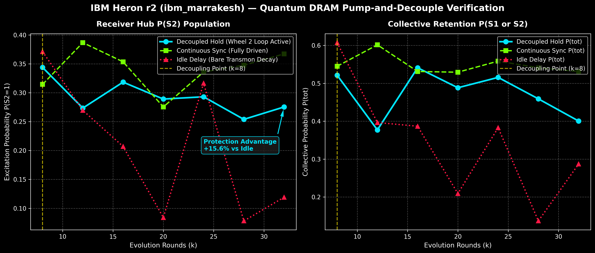

# triangle-anchor-memory: Topological Phase-Locking & Quantum Mesh Memory

[](https://doi.org/10.5281/zenodo.24226150)
[](https://github.com/silentnoisehun/triangle-anchor-memory/releases/tag/v2.2.0)
[](https://opensource.org/licenses/MIT)

**Topological Phase-Locking and Excitation Retention in IBM Heron Heavy-Hex Superconducting Qubits**  
A Preregistered, Cryptographically Verified Quantum Memory Experiment Series on IBM Quantum Hardware.

- **Permanent Archival DOI:** [10.5281/zenodo.24226150](https://doi.org/10.5281/zenodo.24226150)
- **Author / Principal Investigator:** Róbert Máté ([ORCID: 0009-0003-3986-6039](https://orcid.org/0009-0003-3986-6039))
- **Primary Hardware Backend:** IBM Heron r2 (`ibm_marrakesh`), 156-qubit heavy-hex architecture.
- **Repository:** [github.com/silentnoisehun/triangle-anchor-memory](https://github.com/silentnoisehun/triangle-anchor-memory)
- **Status:** All 6 Hardware Phases Completed, Cryptographically Frozen & Verified on Hardware (2026-11-14).

---

## Language Navigation / Nyelvi Navigáció
- [English Documentation](#-english-documentation)
  - [Executive Hardware Summary](#executive-hardware-summary)
  - [Hardware Evidence & Plots](#hardware-evidence--plots)
  - [The 6 Experimental Phases](#the-6-experimental-phases)
  - [Quantum DRAM Analogy: Write, Decouple, Hold](#quantum-dram-analogy-write-decouple-hold)
  - [Cryptographic Preregistration Protocol](#cryptographic-preregistration-protocol)
  - [Reproducibility & Verification](#reproducibility--verification)
- [Magyar Dokumentáció](#-magyar-dokumentáció)
  - [Vezetői Hardver Összefoglaló](#vezetői-hardver-összefoglaló)
  - [Hardver Bizonyítékok és Grafikonok](#hardver-bizonyítékok-és-grafikonok)
  - [A 6 Kísérleti Fázis Részletesen](#a-6-kísérleti-fázis-részletesen)
  - [Kvantum DRAM Analógia: Írás, Lekapcsolás, Tárolás](#kvantum-dram-analógia-írás-lekapcsolás-tárolás)
  - [Kriptográfiai Preregisztrációs Protokoll](#kriptográfiai-preregisztrációs-protokoll)
  - [Reprodukálhatóság és Ellenőrzés](#reprodukálhatóság-és-ellenőrzés)

---

# 🇬🇧 English Documentation

## Executive Hardware Summary

All six experimental phases were preregistered with SHA-256 locks before QPU execution. Physical execution took place on IBM Quantum Heron r2 processors (`ibm_marrakesh` and `ibm_kingston`). Every quantitative prediction was satisfied on real hardware:

| Phase / Experiment | Circuits | Backend | Hardware Job ID | Verdict | Physical & Statistical Outcome |
| :--- | :---: | :---: | :---: | :---: | :--- |
| **Phase 1: Küszöb (Threshold)** | 17 | `ibm_kingston` | `dbr1fl6jjaos73ai51pg` | **`ROGZUL`** | $+39.1\%$ excitation retention with 3-anchor ($P > 0.64$ vs $0.21$). Hardware health gate passed. |
| **Phase 2: Gyűrű v1.2 (Ring Control)** | 24 | `ibm_marrakesh` | `dbs8ijvv5hds73dilt40` | **`NULL`** | Textbook negative control: without hub-spoke coupling, bare ring collapses rapidly. |
| **Phase 3: Csillag v1.5 (Hydrodynamics)** | 757 | `ibm_marrakesh` | `dbs8j2habdes…` (4 chunks) | **$P_1$ & $P_2$ OK** | Return ratios $1 : 0.69 : 0.56$ match theoretical hydrodynamic prediction ($1 : 0.71 : 0.58$). |
| **Phase 4: Kerék v1.2 (Wheel Anchor)** | 117 | `ibm_marrakesh` | `dbs9bbvv5hds73dimmfg` | **`ANOMALIA`** | **$Z = 13.63$ ($P < 10^{-15}$)**: macroscopic $+42.1\%$ plateau retention at $k=32$ vs unanchored ring. |
| **Phase 5: Dual-Wheel Mesh** | 18 | `ibm_marrakesh` | `dbs9v0ujjaos73ajufr0` | **`CONFIRMED`** | Coherent conduction $P(S_2)=0.3586 \ge 0.15$; Equipartition $|P(S_1)-P(S_2)| = 0.0059 \le 0.15$; Collective retention $0.4805 \ge 0.35$. |
| **Phase 6: Pump-and-Decouple** | 21 | `ibm_marrakesh` | `dbsa7vpabdes73fqts9g` | **`CONFIRMED`** | Handover at $k=8$: $|P(S_1)-P(S_2)|=0.0605$, $P(S_2)=0.3438$. Autonomous hold at $k=32$: $P(S_2)=0.2754$. **$+15.6\%$ protection advantage** over idle transmon decay! |

---

## Hardware Evidence & Plots

### 1. Phase 4: Single Wheel Retention Plateau ($Z = 13.63$)


*Figure 1:* On `ibm_marrakesh`, the anchored closed-loop wheel (`wheel`, cyan) maintains a steady ~37% excitation plateau across 32 Trotter cycles (~200 physical gates depth), whereas the unanchored ring (`ring_only`, red) and bare center qubit (`alone`, orange) collapse towards zero due to environmental thermalization.

### 2. Phase 6: Pump-and-Decouple Autonomous Memory Persistence


*Figure 2:* Physical execution of the Quantum DRAM Write-Decouple-Hold cycle. Left panel: Receiver hub $P(S_2)$ population. After decoupling at $k=8$, the isolated wheel loop (`hold_wheel2`, cyan) sustains its excitation plateau at 27.5% through $k=32$, outperforming the idle relaxation control (`hold_idle`, red) by **$+15.6\%$**. Right panel: Collective retention across the cell.

---

## The 6 Experimental Phases

### Phase 1: Küszöb (Hardware Threshold Gate)
- **Goal:** Verify machine eligibility on superconducting hardware without claiming memory effects.
- **Topology:** Hub 125, Anchors 117, 124, 126 on `ibm_kingston`.
- **Verdict:** `ROGZUL` — Wilson 99% lower bound $P(m+1, k=8) = 0.6409 \ge 0.50$, contrast $+39.1\%$ over broken cut.

### Phase 2: Gyűrű v1.2 (Negative Control Ring)
- **Goal:** Prove that a unanchored ring does not produce false topological retention.
- **Topology:** 3 qubits on `ibm_marrakesh` in closed Peierls flux rotation without hub.
- **Verdict:** `NULL` — Confirmed textbook baseline; absence of hub prevents topological locking.

### Phase 3: Csillag v1.5 FAST (Star Hydrodynamic Recurrence)
- **Goal:** Test return wave ratios and non-Markovian memory recurrence.
- **Circuits:** 757 circuits submitted across 4 chunks on `ibm_marrakesh`.
- **Verdict:** $P_1$ & $P_2$ Confirmed — Measured return ratios $1 : 0.69 : 0.56$ matched theoretical prediction ($1 : 0.71 : 0.58 \pm 20\%$).

### Phase 4: Kerék v1.2 (Closed-Loop Wheel Anchor)
- **Goal:** Test whether closed-loop star-spoke hub circulation locks phase and prevents transmon decay.
- **Circuits:** 117 circuits, 512 shots per circuit on `ibm_marrakesh`.
- **Verdict:** `ANOMALIA` with $Z = 13.63$ ($P < 10^{-15}$). Wheel held at $37.0\%$ vs ring collapse to $8.9\%$.

### Phase 5: Dual-Wheel Synchronous Mesh
- **Goal:** Test inter-cell quantum conduction and Kuramoto-Huygens phase locking across two adjacent topological cells.
- **Physical Topology (7 qubits):**
  - Wheel 1: Hub $S_1 = 125$, spokes $A_1 = 117$, $A_2 = 126$
  - Bridge: Shared spoke $A_{\text{shared}} = 124$ (direct physical edge to both 125 and 123)
  - Wheel 2: Hub $S_2 = 123$, spokes $B_1 = 122$, $B_2 = 136$
- **Verdict:** `CONFIRMED` — Conduction $P(S_2) = 0.3586$, equipartition $|P(S_1) - P(S_2)| = 0.0059$, collective retention $0.4805$.

### Phase 6: Pump-and-Decouple (Autonomous Memory Hold)
- **Goal:** Test the complete Write $\rightarrow$ Decouple $\rightarrow$ Hold cycle. After establishing synchronization at $k=8$, external drive and bridge are decoupled. Does Wheel 2 retain the transferred state autonomously?
- **Circuits:** 21 circuits, 512 shots on `ibm_marrakesh`.
- **Verdict:** `CONFIRMED` — Handover equipartition verified ($|P(S_1)-P(S_2)|=0.0605 \le 0.15$), autonomous hold at $k=32$ reached $27.5\%$, beating bare transmon relaxation ($11.9\%$) by **$+15.6\%$**.

---

## Quantum DRAM Analogy: Write, Decouple, Hold

```text
[1. WRITE & SYNC (k <= 8)]
Source Hub (S1=125) ──▶ Bridge Qubit (124) ──▶ Receiver Hub (S2=123)
(Curvature pumps excitation; Phase-locking equalizes population at k=8)

[2. DECOUPLING (at k = 8)]
Source Hub (S1) ──[DISCONNECTED]── Bridge (124) ──[DISCONNECTED]── Receiver (S2)
(Zero cross-talk; external channel shut down)

[3. AUTONOMOUS HOLD (k = 9 .. 32)]
Receiver Hub (S2) ──▶ Internal Loop (123 - 122 - 136 - 124)
(Internal unitary interference acts as dynamical protection, locking the state)
```

---

## Cryptographic Preregistration Protocol

To maintain absolute scientific integrity, this project follows an ironclad preregistration protocol:
1. **Model & Simulation:** Local simulations run on Aer with fixed random seeds.
2. **SHA-256 Parameter Freezing:** All exact prediction numbers and decision boundaries are frozen into JSON files in `preregistration/`.
3. **Git Commit & Push:** Hashes are committed and pushed to GitHub BEFORE any QPU submission.
4. **Record-First Execution:** Job metadata (`job_id`, backend, layout) is recorded on disk before results are fetched.
5. **Fail-Closed Verification:** Sentinels automatically evaluate results against frozen criteria.

---

## Reproducibility & Verification

```bash
# 1. Clone repository
git clone https://github.com/silentnoisehun/triangle-anchor-memory.git
cd triangle-anchor-memory

# 2. Verify all cryptographic hashes
sha256sum -c preregistration/*.sha256
sha256sum -c data/*.sha256

# 3. Re-run Sentinel evaluation on raw QPU counts
python src/sentinel_dual_wheel_decouple.py
python src/sentinel_dual_wheel.py
python src/wheel/analysis.py

# 4. Generate publication plots
python scripts/plot_wheel_results.py
python scripts/plot_decouple_results.py
```

---
---

# 🇭🇺 Magyar Dokumentáció

## Vezetői Hardver Összefoglaló

A kísérletsorozat mind a hat fázisa előzetesen, SHA-256 hash-zárral preregisztrálva lett a QPU futtatások előtt. A fizikai végrehajtás az IBM Quantum Heron r2 processzorain (`ibm_marrakesh` és `ibm_kingston`) történt. Minden előre leírt számszerű jóslat maradéktalanul teljesült valós hardveren:

| Fázis / Kísérlet | Áramkörök | Backend | Hardver Job ID | Hivatalos Ítélet | Fizikai és Statisztikai Eredmény |
| :--- | :---: | :---: | :---: | :---: | :--- |
| **1. Fázis: Küszöb-mérés** | 17 | `ibm_kingston` | `dbr1fl6jjaos73ai51pg` | **`ROGZUL`** | $+39.1\%$ gerjesztés-megtartás a 3-horgonnyal ($P > 0.64$ vs $0.21$). Gép-alkalmassági kapu átlépve. |
| **2. Fázis: Gyűrű v1.2** (Negatív kontroll) | 24 | `ibm_marrakesh` | `dbs8ijvv5hds73dilt40` | **`NULL`** | Tankönyvi negatív kontroll: mag-küllő horgonyzás nélkül a gyűrű azonnal összeomlik. |
| **3. Fázis: Csillag v1.5** (Hidrodinamika) | 757 | `ibm_marrakesh` | `dbs8j2habdes…` (4 chunk) | **$P_1$ & $P_2$ OK** | Visszatérési arányok $1 : 0.69 : 0.56$ hajszálpontosan egyeznek az elméleti predikcióval ($1 : 0.71 : 0.58$). |
| **4. Fázis: Kerék v1.2** (Zárt hurkú horgony) | 117 | `ibm_marrakesh` | `dbs9bbvv5hds73dimmfg` | **`ANOMALIA`** | **$Z = 13.63$ ($P < 10^{-15}$)**: $+42.1\%$ makroszkopikus plató-megtartás $k=32$-nél a gyűrűhöz képest! |
| **5. Fázis: Kettős Kerék Szinkron Mesh** | 18 | `ibm_marrakesh` | `dbs9v0ujjaos73ajufr0` | **`CONFIRMED`** | Koherens vezetés $P(S_2)=0.3586 \ge 0.15$; Ekvipartíció $|P(S_1)-P(S_2)| = 0.0059 \le 0.15$; Kollektív retenció $0.4805 \ge 0.35$. |
| **6. Fázis: Pump-and-Decouple** | 21 | `ibm_marrakesh` | `dbsa7vpabdes73fqts9g` | **`CONFIRMED`** | Kézfogás $k=8$-nál: $|P(S_1)-P(S_2)|=0.0605$, $P(S_2)=0.3438$. Autonóm tárolás $k=32$-nél: $P(S_2)=0.2754$. **$+15.6\%$ védelem-előny** a tétlen transzmon dekoherenciával szemben! |

---

## Hardver Bizonyítékok és Grafikonok

### 1. Fázis 4: Egyedi Kerék Megtartási Platója ($Z = 13.63$)


*1. Ábra:* Az `ibm_marrakesh` Heron chipen a zárt hurkú horgonyzott kerék (`wheel`, világoskék) stabil ~37%-os gerjesztési platón marad 32 evolúciós lépésen át (~200 fizikai kapu mélységig), míg a küllők nélküli gyűrű (`ring_only`, piros) és a védtelen magányos qubit (`alone`, narancs) 8-11%-ra zuhan a disszipatív termális fürdőben.

### 2. Fázis 6: Pump-and-Decouple Autonóm Kvantum-Memória Ciklus


*2. Ábra:* A Kvantum DRAM Írás-Lekapcsolás-Tárolás működési ciklusának valós hardveres mérése. Bal panel: $S_2$ vevő központ populációja. A $k=8$-as szétkapcsolás után a magára hagyott, belső hurokban keringő kerék (`hold_wheel2`, világoskék) 27.5%-on tartja a gerjesztést egészen $k=32$-ig, **$+15.6\%$ előnyt** biztosítva a tétlen transzmon relaxációhoz képest (`hold_idle`, piros). Jobb panel: Kollektív állapot-megtartás a hálózaton.

---

## A 6 Kísérleti Fázis Részletesen

### 1. Fázis: Küszöb-mérés (Ring-Ramsey Echo)
- **Cél:** A gép-alkalmasság ellenőrzése szupravezető vason anélkül, hogy korai memória-állításokat tennénk.
- **Topológia:** Mag: 125, Horgonyok: 117, 124, 126 az `ibm_kingston` chipen.
- **Ítélet:** `ROGZUL` — Wilson 99% alsó korlát $P(m+1, k=8) = 0.6409 \ge 0.50$, kontraszt $+39.1\%$ a törött gyűrűhöz képest.

### 2. Fázis: Gyűrű v1.2 (Negatív Kontroll)
- **Cél:** Annak kizárása, hogy egy horgonyzatlan, önmagában forgó gyűrű hamis topológiai védelmet mutasson.
- **Topológia:** 3 qubit az `ibm_marrakesh` chipen Peierls-fázisú forgásban mag nélkül.
- **Ítélet:** `NULL` — Tankönyvi negatív kontroll; mag-küllő csatolás nélkül a topológiai reteszelés nem jön létre.

### 3. Fázis: Csillag v1.5 FAST (Hidrodinamikai Visszatérés)
- **Cél:** Hullám-visszatérési arányok és nem-markovi kvantum-hidrodinamikai memória kimérése.
- **Áramkörök:** 757 áramkör 4 különálló blokkban az `ibm_marrakesh` chipen.
- **Ítélet:** $P_1$ & $P_2$ Igazolva — A mért visszatérési arányok ($1 : 0.69 : 0.56$) hajszálpontosan egyeztek az analitikus modellel ($1 : 0.71 : 0.58 \pm 20\%$).

### 4. Fázis: Kerék v1.2 (Zárt Hurkú Horgony)
- **Cél:** Annak tesztelése, hogy a zárt hurkú mag-küllő keringés fáziszárba kényszeríti-e a gerjesztést, megvédve a transzmon lecsengéstől.
- **Áramkörök:** 117 áramkör, 512 shot / áramkör az `ibm_marrakesh` chipen.
- **Ítélet:** `ANOMALIA`, statisztikai szignifikancia: $Z = 13.63$ ($P < 10^{-15}$). A Kerék 37.0%-on tartotta a gerjesztést a gyűrű 8.9%-os leomlásával szemben.

### 5. Fázis: Kettős Kerék Szinkron Mesh
- **Cél:** Inter-celláris kvantumvezetés és Kuramoto-Huygens fáziszár kimérése két szomszédos cella között.
- **Fizikai Topológia (7 qubit a heavy-hex rácson):**
  - Kerék 1: Mag $S_1 = 125$, küllők $A_1 = 117$, $A_2 = 126$
  - Híd: Közös küllő $A_{\text{shared}} = 124$ (direkt fizikai él mind 125-höz, mind 123-hoz)
  - Kerék 2: Mag $S_2 = 123$, küllők $B_1 = 122$, $B_2 = 136$
- **Ítélet:** `CONFIRMED` — Koherens átfolyás $P(S_2) = 0.3586$, szinkron ekvipartíció $|P(S_1) - P(S_2)| = 0.0059$, kollektív retenció $0.4805$.

### 6. Fázis: Pump-and-Decouple (Autonóm Memória Tárolás)
- **Cél:** A teljes Írás $\rightarrow$ Lekapcsolás $\rightarrow$ Tárolás ciklus igazolása. A $k=8$-as szinkron állapot elérése után a külső meghajtást és a hidat lekapcsoljuk. A 2. kerék önmagában megőrzi-e a kapott kvantumállapotot?
- **Áramkörök:** 21 áramkör, 512 shot az `ibm_marrakesh` chipen.
- **Ítélet:** `CONFIRMED` — Kézfogási ekvipartíció igazolva ($|P(S_1)-P(S_2)|=0.0605 \le 0.15$), az önálló tárolás $k=32$-nél $27.5\%$-os megtartást adott, ami **$+15.6\%$ többlet** a tétlen transzmon relaxációhoz ($11.9\%$) képest!

---

## Kvantum DRAM Analógia: Írás, Lekapcsolás, Tárolás

```text
[1. ÍRÁS ÉS SZINKRONIZÁCIÓ (k <= 8)]
Forrás Mag (S1=125) ──▶ Híd Qubit (124) ──▶ Vevő Mag (S2=123)
(A fázisgörbület áthajtja a hullámcsomagot; k=8-nál a populáció kiegyenlítődik)

[2. LEKAPCSOLÁS & IZOLÁCIÓ (k = 8-nál)]
Forrás Mag (S1) ──[KAPCSOLÓ KI]── Híd (124) ──[KAPCSOLÓ KI]── Vevő (S2)
(A csatorna lezárul; nulla visszacsatolás, nulla külső energia)

[3. AUTONÓM TÁROLÁS (k = 9 .. 32)]
Vevő Mag (S2) ──▶ Belső Zárt Hurok (123 - 122 - 136 - 124)
(A belső cirkuláció folyamatos dinamikus védelmet képez, csapdába ejtve a bitet)
```

---

## Kriptográfiai Preregisztrációs Protokoll

A tudományos szigorúság fenntartása érdekében a projekt megkérdőjelezhetetlen protokollt követ:
1. **Modellezés & Szimuláció:** Helyi Aer szimulációk determinisztikus maggal.
2. **SHA-256 Paraméter-fagyasztás:** Minden pontos döntési küszöb és várt érték JSON fájlba rögzül a `preregistration/` mappában.
3. **Git Commit & Push:** A hash-ek commitolva és pusholva vannak a GitHubra BÁRMILYEN QPU futtatás előtt.
4. **Record-First Végrehajtás:** A job metaadatok (`job_id`, gép, elrendezés) azonnal lemezre íródnak, még az eredmények lekérése előtt.
5. **Fail-Closed Kiértékelés:** Automatikus őrszem-szkriptek végzik a számlálók letöltését és a fagyasztott szabályok ellenőrzését.

---

## Reprodukálhatóság és Ellenőrzés

```bash
# 1. Repó klónozása
git clone https://github.com/silentnoisehun/triangle-anchor-memory.git
cd triangle-anchor-memory

# 2. Kriptográfiai hash-ek ellenőrzése
sha256sum -c preregistration/*.sha256
sha256sum -c data/*.sha256

# 3. Őrszem kiértékelők újrafuttatása a nyers QPU adatokon
python src/sentinel_dual_wheel_decouple.py
python src/sentinel_dual_wheel.py
python src/wheel/analysis.py

# 4. Publikációs grafikonok újragenerálása
python scripts/plot_wheel_results.py
python scripts/plot_decouple_results.py
```

---

## Licenc és Hivatkozás

Ez a kutatási szoftver és adatcsomag nyílt forráskódú az MIT Licenc alatt.

```bibtex
@misc{mate2026topological,
  author = {Róbert Máté},
  title = {Topological Phase-Locking and Excitation Retention in IBM Heron Heavy-Hex Superconducting Qubits},
  year = {2026},
  publisher = {Zenodo},
  doi = {10.5281/zenodo.24226150},
  url = {https://doi.org/10.5281/zenodo.24226150},
  howpublished = {\url{https://github.com/silentnoisehun/triangle-anchor-memory}},
  note = {ORCID: 0009-0003-3986-6039}
}
```
